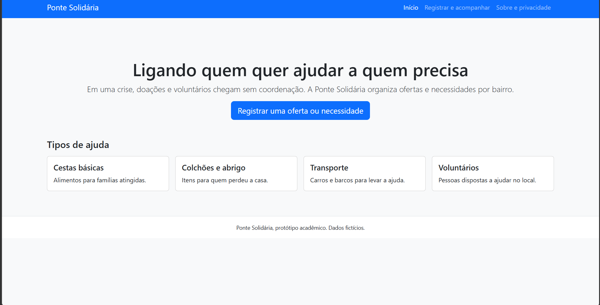
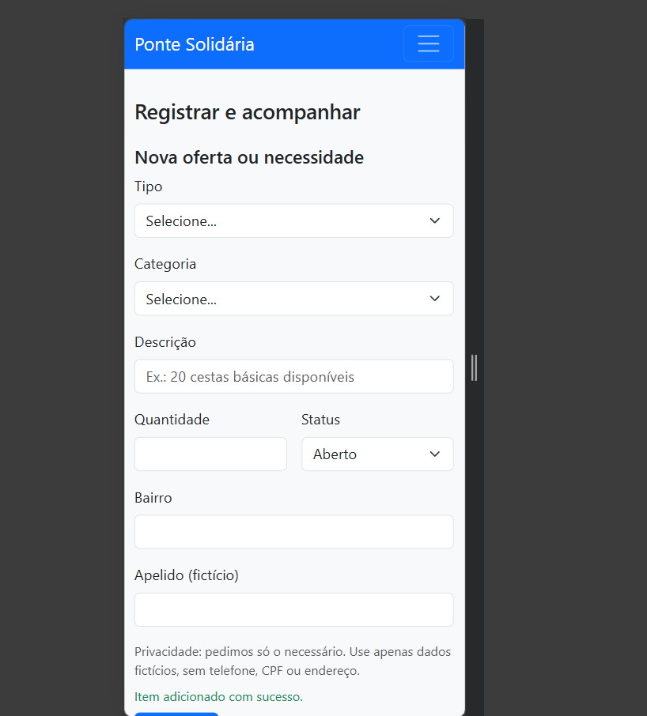
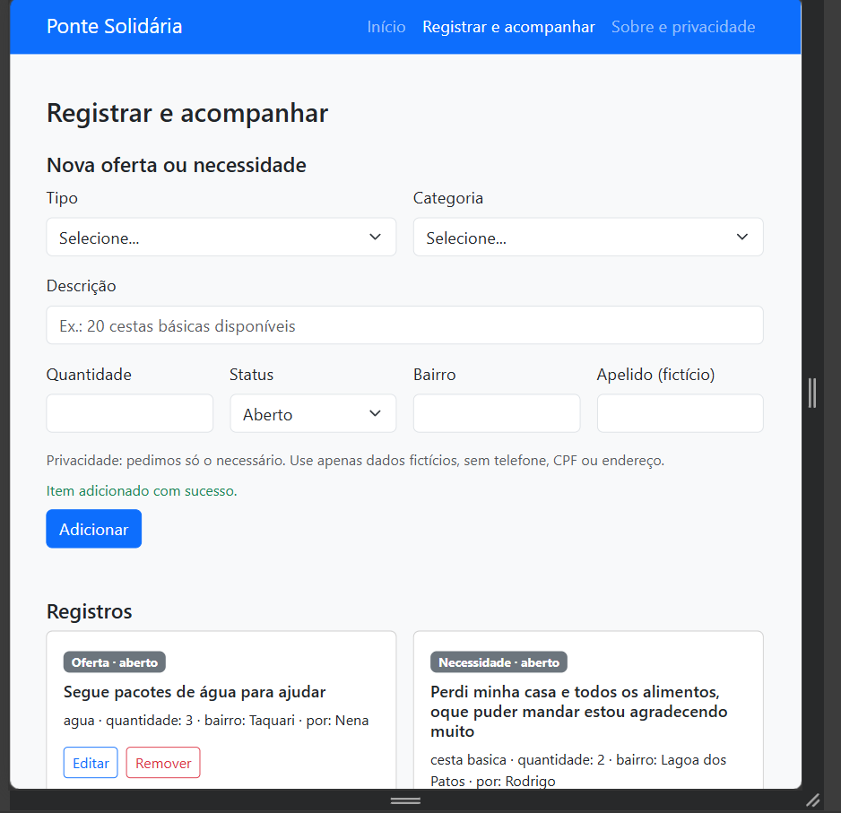
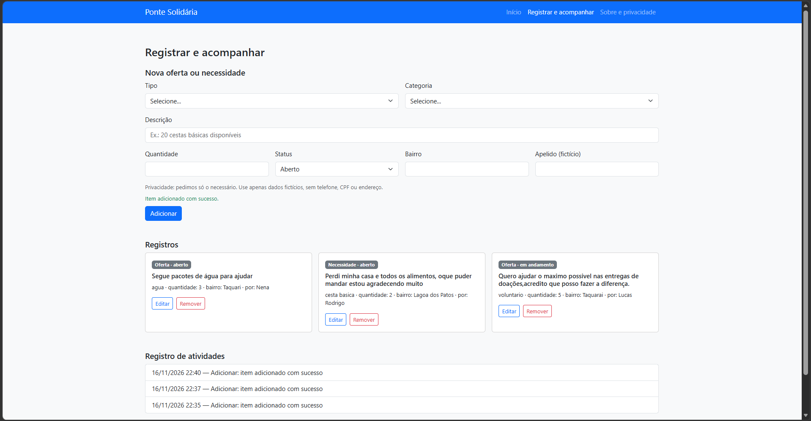
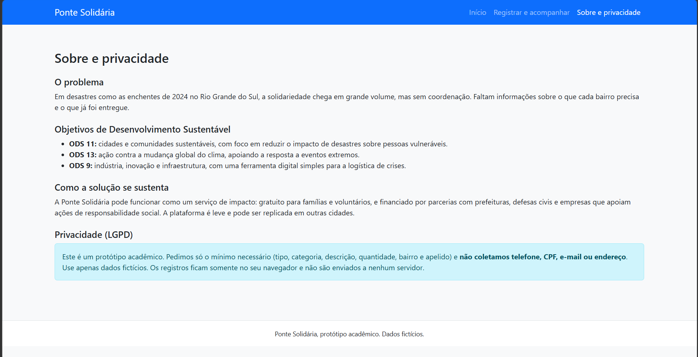

# Ponte Solidária

Protótipo de site para a avaliação de Desenvolvimento Web I (tema Tecnologia Cidadã: clima, riscos e emergências).

## Objetivo

Ajudar a coordenar doações, voluntários e recursos em situações de crise, como enchentes, ligando quem quer ajudar a quem precisa, organizado por bairro.

## Problema e cidadão

- **Cidadão afetado:** famílias atingidas por desastres climáticos e as pessoas que organizam a ajuda (voluntários, ONGs e Defesa Civil).
- **Problema:** em uma crise chega muita doação, mas sem organização. Faltam informações sobre o que cada local precisa e o que já foi entregue.
- **Evidência:** nas enchentes do Rio Grande do Sul em 2024, distribuir as doações virou um problema de logística e o governo estadual criou um canal para orientar grandes cargas (fontes no relatório em PDF).
- **ODS:** 11, 13 e 9.

## Funcionalidades

- 3 páginas com HTML semântico e navegação entre elas
- Formulário com validação HTML5 e validação em JavaScript, com mensagens na tela
- Adicionar, listar, editar e remover registros, atualizando a página pelo DOM
- Painel de registro de atividades com data/hora, ação e resultado
- Dados mantidos no localStorage do navegador
- Layout responsivo (Mobile First) com Flexbox, Grid e Bootstrap

## Tecnologias

HTML5, CSS3, JavaScript, Bootstrap 5.3.3 (via CDN, código de terceiros), Git e GitHub.

## Como executar

1. Baixe ou clone o repositório.
2. Abra a pasta no VS Code e use a extensão Live Server (botão direito em `index.html` > Open with Live Server).
3. Se preferir, abra o `index.html` com dois cliques no navegador.

## Estrutura de pastas

```
ponte-solidaria/
├── index.html        página inicial
├── registro.html     formulário, lista e painel de atividades
├── sobre.html        ODS, modelo de negócio e privacidade
├── css/
│   └── estilo.css    estilos e media queries
├── js/
│   ├── validacao.js  regras de validação
│   ├── log.js        painel de atividades
│   ├── dados.js      adicionar, listar, editar e remover
│   └── main.js       eventos e atualização da tela
└── img/              prints das telas
```

## Privacidade e segurança

- Coleta mínima de dados (sem telefone, CPF, e-mail ou endereço) e uso apenas de dados fictícios.
- Toda entrada é validada (campo vazio, tamanho, formato e tipo).
- Textos entram na página com `textContent`, e não `innerHTML`.
- Mensagens de erro sem detalhes técnicos para o usuário.

## Documentação do código

### js/validacao.js
- `limparTexto`: tira espaços extras do texto digitado.
- `validarOpcao`: confere se o valor está em uma lista fixa (tipo, categoria, status).
- `validarTexto`: confere se o texto não está vazio e respeita o tamanho mínimo e máximo.
- `validarFormatoTexto`: aceita só letras, números e pontuação simples (barra `<` e `>`).
- `validarQuantidade`: confere se é um número inteiro de 1 a 999.
- `validarCampoTexto`: junta a validação de tamanho e de formato.
- `validarRegistro`: valida todos os campos e devolve se está válido e quais são os erros.

### js/dados.js
- `gerarId`: cria um identificador único para cada registro.
- `itemEhValido`: confere se um item lido do armazenamento tem o formato certo.
- `salvarRegistros` e `carregarRegistros`: guardam e leem a lista no localStorage.
- `listarRegistros` e `buscarRegistro`: devolvem a lista ou um item pelo id.
- `adicionarRegistro`, `editarRegistro` e `removerRegistro`: validam, alteram a lista, salvam e registram a atividade.

### js/log.js
- `obterDataHoraAtual`: devolve a data e a hora no formato 17/11/2026 08:30.
- `montarTextoAtividade`: monta o texto de uma linha do painel.
- `mostrarAtividades`: desenha o painel na página.
- `registrarAtividade`: guarda a atividade (data/hora, ação e resultado) e atualiza o painel.

### js/main.js
- `lerFormulario`, `limparErros`, `mostrarErros` e `mostrarMensagem`: ler o formulário e mostrar as mensagens na tela.
- `criarElemento` e `criarCartaoRegistro`: montam os cards da lista pelo DOM.
- `desenharLista`: redesenha a lista de registros.
- `entrarNoModoEdicao` e `sairDoModoEdicao`: preenchem o formulário para editar e voltam ao modo de adicionar.
- `aoEnviarFormulario`: trata o envio do formulário (adicionar ou editar).
- `aoClicarNaLista`: trata os cliques nos botões Editar e Remover.
- `iniciarPagina`: carrega os dados e liga os eventos quando a página abre.

## Prints das telas

# Página inicial (desktop)


### Registro: celular (375px)


### Registro: tablet (768px)


### Registro: desktop (1280px)


### Sobre e privacidade


## Autor

Icaro, Desenvolvimento Web I.